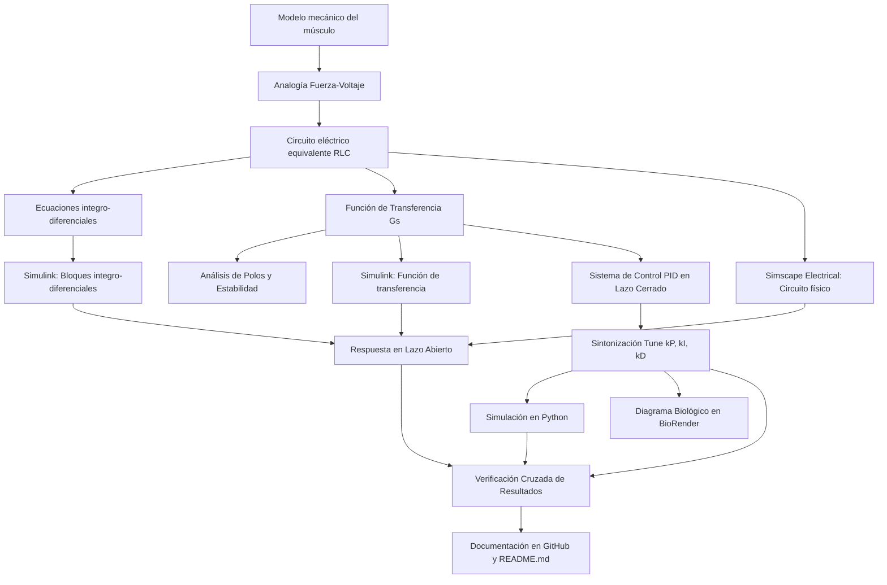

[](https://matlab.mathworks.com/open/github/v1?repo=DrPaulValle/MSF-IBF1020)

# Práctica 3: Modelado y control del sistema musculoesquelético

Repositorio académico de la asignatura **Modelado de Sistemas Fisiológicos**, correspondiente al programa de **Ingeniería Biomédica** del Tecnológico Nacional de México / Instituto Tecnológico de Tijuana. Esta práctica integra el modelado mecánico del tejido muscular, su conversión a analogías eléctricas mediante la relación fuerza–voltaje, análisis temporal y de estabilidad, diseño de controladores PID, simulación computacional *in silico* y verificación cruzada entre múltiples plataformas.

El caso de estudio analiza las propiedades viscoelásticas del sistema musculoesquelético mediante una combinación de elementos contráctiles pasivos y activos, resortes y amortiguadores. Se busca evaluar y comparar la respuesta del desplazamiento $x(t)$ ante una fuerza aplicada $F(t)$, evaluando la condición de un **individuo sano (control)** frente a un **caso simulado de atrofia muscular (caso)**, tanto en lazo abierto como en lazo cerrado mediante un controlador PID.

**Docente:** Dr. Paul Antonio Valle Trujillo 
**Correo:** paul.valle@tectijuana.edu.mx  
**Departamento:** Ingeniería Eléctrica y Electrónica 
**Institución:** Tecnológico Nacional de México / Instituto Tecnológico de Tijuana 
**Asignatura:** Modelado de Sistemas Fisiológicos
**Programa:** Ingeniería Biomédica
**Estudiante:** Nicole Arredondo Arevalo· 23212179 · L23212179@tijuana.tecnm.mx  

**Repositorio de la asignatura:** https://github.com/DrPaulValle/MSF-IBF1020  
**Sede:** Blvd. Alberto Limón Padilla s/n, Tijuana, C. P. 22454, B. C., México.

---

<a id="contenido"></a>
## Contenido

1. [Resumen](#resumen)
2. [Competencia y objetivos](#objetivos)
3. [Relación con el temario](#temario)
4. [Modelo físico y analogía eléctrica](#analogia)
5. [Formulación matemática](#modelo)
6. [Análisis temporal y de estabilidad](#analisis)
7. [Señales de entrada y condiciones de simulación](#senales)
8. [Implementación en MATLAB, Simulink y Simscape](#matlab)
9. [Control en lazo cerrado y sintonización PID](#pid)
10. [Reproducción en Python](#python)
11. [Verificación entre representaciones](#verificacion)
12. [Resultados y verificación cruzada](#resultados)
13. [Flujo de trabajo](#flujo)
14. [Actividades del estudiante](#actividades)
15. [Estructura del repositorio](#estructura)
16. [Requisitos](#requisitos)
17. [Reproducibilidad y entregables](#reproducibilidad)
18. [Referencias](#referencias)

---

<a id="resumen"></a>
## Resumen

La práctica tiene como propósito **desarrollar un procedimiento completo de modelado, análisis, simulación y control *in silico*** para el sistema musculoesquelético. Las propiedades viscoelásticas del tejido muscular se representan mediante una estructura mecánica constituida por un elemento contráctil $F_0(t)$, una amortiguación viscosa $R$ y elementos elásticos en serie ($C_s$) y en paralelo ($C_p$).

A través de la **analogía fuerza–voltaje**, los elementos mecánicos se transforman en un circuito eléctrico equivalente donde las fuerzas corresponden a voltajes, las velocidades a corrientes y los desplazamientos a carga eléctrica. Se estudia el comportamiento dinámico comparando un sujeto sano frente a una patología de atrofia muscular representada por una alteración en la componente viscosa $R$. Se incorpora un **controlador PID con retroalimentación negativa** que toma la respuesta del sujeto sano como referencia para corregir la respuesta del sujeto con atrofia. Los resultados se validan mediante MATLAB, Simulink, Simscape Electrical y Python.

**Palabras clave:** Sistema musculoesquelético; Atrofia muscular; Analogía fuerza-voltaje; Controlador PID; Modelo viscoelástico; BioRender; MATLAB; Simulink; Simscape Electrical; Python; Simulación *in silico*.

[Volver al contenido](#contenido)

---

<a id="objetivos"></a>
## Competencia y objetivos

### Competencia a desarrollar

Modelizar sistemas fisiológicos mediante analogías entre sistemas físicos, ecuaciones diferenciales y funciones de transferencia para analizar su comportamiento dinámico y diseñar estrategias de control clásico. En particular, analizar un modelo mecánico del sistema musculoesquelético, construir su circuito eléctrico equivalente, comparar la respuesta de un individuo sano frente a un caso de atrofia muscular y diseñar una estrategia de control *in silico* para atenuar las diferencias dinámicas.

### Objetivo general

Modelar, analizar y simular la respuesta dinámica del sistema musculoesquelético ante una fuerza aplicada mediante su formulación matemática, analogía eléctrica equivalente y control por retroalimentación negativa, comparando la respuesta temporal de la condición de referencia (sano) y el caso patológico (atrofia).

### Objetivos específicos

- Identificar los componentes viscoelásticos (elemento contráctil, amortiguamiento viscoso, elasticidades serie y paralelo) y las variables de fuerza y desplazamiento.
- Construir el circuito eléctrico equivalente aplicando la analogía fuerza–voltaje y sus reglas topológicas.
- Derivar las ecuaciones diferenciales y la función de transferencia $G(s) = X(s)/F(s)$ para los casos de referencia y atrofia muscular.
- Analizar la estabilidad y localización de polos en el plano complejo para ambas condiciones.
- Simular la respuesta en lazo abierto ante un impulso unitario en MATLAB, Simulink, Simscape y Python.
- Diseñar y sintonizar un controlador PID para atenuar el error $e(t) = x_{\text{control}}(t) - x_{\text{caso}}(t)$.
- Validar y verificar cruzadamente las respuestas computacionales obtenidas en las diferentes herramientas.
- Elaborar un diagrama biológico en BioRender que relacione las estructuras mecánicas con los equivalentes eléctricos.

[Volver al contenido](#contenido)

---

<a id="temario"></a>
## Relación con el temario

La práctica integra contenidos correspondientes a las tres unidades principales de la asignatura **Modelado de Sistemas Fisiológicos (IBF-1020)**:

| Unidad | Área | Contenidos aplicados |
|---|---|---|
| I | Sistemas de control retroalimentados | Diagramas de bloques, respuesta ante impulso, análisis de error y criterios de estabilidad en el plano complejo. |
| II | Modelado matemático | Analogía mecánica–eléctrica (fuerza–voltaje), leyes de Kirchhoff, modelo dinámico del sistema musculoesquelético y función de transferencia. |
| III | Controladores | Configuración del controlador PID, sintonización de ganancias $k_P, k_I, k_D$ y retroalimentación negativa. |

[Volver al contenido](#contenido)

---

<a id="analogia"></a>
## Modelo físico y analogía eléctrica

### Descripción del modelo mecánico

El compartimento musculoesquelético se aproxima mediante un modelo mecánico compuesto por:
- $F_0(t)$: Fuerza desarrollada por el elemento contráctil activo del músculo ($F_0(t) = \alpha F(t)$, con $0 < \alpha < 1$).
- $R$: Amortiguación viscosa inherente al tejido muscular.
- $C_s$: Elasticidad del elemento en serie (asociada a los tendones).
- $C_p$: Elasticidad del elemento en paralelo (asociada al sarcolema y estructuras pasivas).
- $x(t)$: Desplazamiento total del elemento elástico paralelo.
- $x_1(t)$: Desplazamiento del elemento elástico en serie $C_s$.

### Analogía Fuerza–Voltaje (Mecánica a Eléctrica)

| Sistema mecánico | Variable eléctrica análoga | Interpretación fisiológica |
|---|---|---|
| Fuerza $F(t)$
 | Voltaje $V(t)$ | Fuerza de tracción / excitación muscular |
| Velocidad $\dot{x}(t)$ | Corriente $I(t)$ | Velocidad de deformación muscular |
| Desplazamiento $x(t)$ | Carga eléctrica $q(t)$ | Deformación / elongación muscular |
| Amortiguador $R$ | Resistencia $R$ | Viscosidad y fricción tisular |
| Compliancia $C_s, C_p$ | Capacitancia $C_s, C_p$ | Elasticidad pasiva y tendinosa |
| Masa $M$ | Inductancia $L$ | Inercia de la masa muscular |

> **Regla topológica de conversión:** Los componentes mecánicos conectados en paralelo se representan mediante elementos eléctricos en serie, mientras que elementos mecánicos en serie se representan como elementos eléctricos en paralelo.

### Parámetros eléctricos equivalentes para la simulación

| Parámetro | Unidades | Condición Control (Sano) | Condición Caso (Atrofia) |
|---|---|---|---|
| Entradas $F(t)$ | $\mathrm{V}$ | $1\,\mathrm{V}$ | $1\,\mathrm{V}$ |
| Factor $\alpha$ | Adimensional | $0.25$ | $0.25$ |
| Compliancia serie $C_s$ | $\mu\mathrm{F}$ | $10\,\mu\mathrm{F}$ | $10\,\mu\mathrm{F}$ |
| Compliancia paralelo $C_p$ | $\mu\mathrm{F}$ | $100\,\mu\mathrm{F}$ | $100\,\mu\mathrm{F}$ |
| Resistencia viscosa $R$ | $\Omega$ | $100\,\Omega$ | $10\,\mathrm{k}\Omega$ ($10\,000\,\Omega$) |

La atrofia muscular se modela incrementando la resistencia $R$ de $100\,\Omega$ a $10\,\mathrm{k}\Omega$, afectando la componente viscosa y alterando la respuesta temporal del músculo.

[Volver al contenido](#contenido)

---

<a id="modelo"></a>
## Formulación matemática

### 1. Ecuaciones del circuito y del sistema

A partir del equilibrio de fuerzas y las relaciones constitutivas del circuito equivalente, considerando el desplazamiento $x(t)$ como la variable de salida, se establece la relación integro-diferencial que rige la dinámica del sistema.

### 2. Función de transferencia

Aplicando la transformada de Laplace con condiciones iniciales nulas ($\mathcal{L}\{\cdot\}$), se obtiene la función de transferencia entre el desplazamiento y la fuerza aplicada:

$$\boxed{G(s) = \frac{X(s)}{F(s)}}$$

Sustituyendo los parámetros numéricos para cada caso:
- $G_{\text{control}}(s)$ para el individuo sano ($R = 100\,\Omega$).
- $G_{\text{caso}}(s)$ para el caso de atrofia ($R = 10\,\mathrm{k}\Omega$).

[Volver al contenido](#contenido)

---

<a id="analisis"></a>
## Análisis temporal y de estabilidad

### 1. Error en estado estacionario

El error en estado estacionario se evalúa considerando la respuesta final ante la señal de entrada, analizando cómo el cambio de la resistencia viscosa $R$ impacta el valor final y el seguimiento de referencia.

### 2. Polos y estabilidad

Se calculan las raíces del denominador de la función de transferencia $G(s)$:
- Para $R, C_s, C_p > 0$, los polos se ubican en el semiplano izquierdo del plano complejo ($\mathrm{Re}(\lambda_i) < 0$), lo que garantiza la estabilidad BIBO del sistema.
- Se compara el movimiento de los polos al cambiar de $R = 100\,\Omega$ a $R = 10\,\mathrm{k}\Omega$, analizando el nivel de amortiguamiento y la velocidad de respuesta del sistema muscular atrófico.

[Volver al contenido](#contenido)

---

<a id="senales"></a>
## Señales de entrada y condiciones de simulación

El intervalo nominal de simulación se establece en $0 \le t \le 10\,\mathrm{s}$.

| Señal | Definición computacional | Propósito |
|---|---|---|
| Impulso unitario | Pulso rectangular de alta amplitud o función impulso en $t=0$ | Evaluar la respuesta natural y la relajación viscoelástica muscular |

[Volver al contenido](#contenido)

---

<a id="matlab"></a>
## Implementación en MATLAB, Simulink y Simscape

Se evalúan tres representaciones equivalentes para ambas condiciones (Control y Caso):

| Implementación | Descripción | Aspecto a verificar |
|---|---|---|
| Modelo integro-diferencial | Diagrama de bloques en Simulink basado en ecuaciones de equilibrio | Correcta integración de las derivadas de deformación |
| Función de transferencia | Bloque `Transfer Fcn` con $G(s)$ | Respuesta dinámica entrada-salida |
| Circuito Simscape Electrical | Esquema físico con componentes de dominio eléctrico | Consistencia entre la analogía física y los bloques matemáticos |

[Volver al contenido](#contenido)

---

<a id="pid"></a>
## Control en lazo cerrado y sintonización PID

### 1. Esquema de retroalimentación

Se utiliza la respuesta del individuo sano $x_{\text{control}}(t)$ como señal de referencia. La señal de error aplicada al controlador está dada por:

$$e(t) = x_{\text{control}}(t) - x_{\text{caso}}(t)$$

El controlador PID genera una señal de corrección $u(t)$ que actúa sobre el modelo del paciente atrófico para igualar la respuesta dinámica del sujeto sano.

### 2. Sintonización

Utilizando la herramienta **Tune** del bloque `PID Controller` en Simulink, se determinan las ganancias óptimas $k_P$, $k_I$ y $k_D$. El objetivo es lograr una respuesta estable que minimice el error de seguimiento y elimine oscilaciones indeseadas.

[Volver al contenido](#contenido)

---

<a id="python"></a>
## Reproducción en Python

A través de **Visual Studio Code** y la biblioteca `scipy.signal` / `control`, se implementan los scripts en Python para:
1. Definir las funciones de transferencia $G_{\text{control}}(s)$ y $G_{\text{caso}}(s)$.
2. Obtener la respuesta al impulso en lazo abierto.
3. Configurar el lazo cerrado incorporando el PID con las ganancias $k_P, k_I, k_D$ sintonizadas.
4. Exportar los gráficos resultantes a formato PDF para su integración en la documentación.

[Volver al contenido](#contenido)

---

<a id="verificacion"></a>
## Verificación entre representaciones

Se comparan las respuestas numéricas obtenidas en:
- Ecuaciones integro-diferenciales (Simulink)
- Función de transferencia (Simulink)
- Circuito Simscape Electrical
- Cuaderno computacional de MATLAB (`.mlx`)
- Código ejecutable en Python (`.py`)

Todas las representaciones deben alinearse con precisión matemática, justificando cualquier ligera desviación asociada al solucionador numérico (*solver*) empleado.

[Volver al contenido](#contenido)

---

<a id="resultados"></a>
## Resultados y verificación cruzada

Convención gráfica de colores utilizada:
- **Línea Amarilla:** Señal de entrada / Referencia aplicada.
- **Línea Azul:** Respuesta de la planta en lazo abierto (Sujeto Sano - Control).
- **Línea Roja / Guiones:** Respuesta de la planta en lazo abierto (Sujeto con Atrofia - Caso).
- **Línea Verde:** Respuesta en lazo cerrado con controlador PID .

[Volver al contenido](#contenido)

---

<a id="flujo"></a>
## Flujo de trabajo



[Volver al contenido](#contenido)

---

<a id="actividades"></a>
## Actividades del estudiante

- [ ] **Etapa 1:** Analizar el modelo mecánico y transformar las variables a la analogía eléctrica fuerza–voltaje.
- [ ] **Etapa 2:** Derivar las ecuaciones diferenciales y la función de transferencia $G(s)$ para los casos de Control y Caso.
- [ ] **Etapa 3:** Realizar el análisis de estabilidad y ubicación de polos para ambas condiciones.
- [ ] **Etapa 4:** Construir los modelos en Simulink (ecuaciones y $G(s)$) y Simscape Electrical.
- [ ] **Etapa 5:** Diseñar el lazo cerrado en Simulink, sintonizar el PID y registrar las ganancias $k_P, k_I, k_D$.
- [ ] **Etapa 6:** Reproducir la simulación mediante código en Python dentro de Visual Studio Code.
- [ ] **Etapa 7:** Diseñar el diagrama biológico representativo en BioRender.
- [ ] **Etapa 8:** Documentar el trabajo, subir código y figuras al repositorio de GitHub y completar el archivo `CITATION.cff`.

[Volver al contenido](#contenido)

---

<a id="estructura"></a>
## Estructura del repositorio

```text
.
├── README.md                      # Reporte de la práctica y guía de reproducción
├── CITATION.cff                   # Archivo de citación académica
├── Apellido_NoControl.mlx         # Cuaderno de MATLAB del estudiante
├── Apellido_NoControl.pdf         # Exportación del cuaderno de MATLAB
├── modelo_musculoesqueletico.slx  # Modelo de Simulink y Simscape
├── modelo_musculoesqueletico.py   # Script de simulación en Python
├── diagrama_biologico.png        # Ilustración elaborada en BioRender
└── evidencias/                   # Gráficas en formato PDF/PNG y capturas
```

[Volver al contenido](#contenido)

---

<a id="requisitos"></a>
## Requisitos

### Software
- **MATLAB** (con Simulink y Control System Toolbox).
- **Simscape Electrical**.
- **Python 3.x** con entornos **Visual Studio Code**.
- Bibliotecas de Python: `numpy`, `scipy`, `matplotlib`, `control`.
- **BioRender** (o herramienta equivalente) para diagramas biológicos.
- **Git** y **GitHub** para control de versiones y publicación.

[Volver al contenido](#contenido)

---

<a id="reproducibilidad"></a>
## Reproducibilidad y entregables

### Resultados mínimos esperados

| Entregable | Contenido requerido |
|---|---|
| **Matemático** | Ecuaciones integro-diferenciales, función de transferencia $G(s)$ y polos de ambos casos. |
| **Simulink** | Modelo `.slx` con bloques matemáticos, función de transferencia y Simscape. |
| **Control PID** | Ganancias sintonizadas ($k_P, k_I, k_D$) y gráfica comparativa del lazo cerrado. |
| **Python** | Código `.py` ejecutable y gráficos exportados en PDF. |
| **Diagrama** | Esquema biológico-eléctrico exportado desde BioRender. |
| **Repositorio** | `README.md`, `CITATION.cff`, código fuente y gráficos organizados. |

[Volver al contenido](#contenido)

---

<a id="referencias"></a>
## Referencias

[1] M. C. Khoo, *Physiological Control Systems: Analysis, Simulation, and Estimation*, 2nd ed., IEEE Press, 2018.  
[2] F. C. Hoppensteadt y C. S. Peskin, *Modeling and Simulation in Medicine and the Life Sciences*, Springer.  
[3] J. E. Hall, *Guyton and Hall Textbook of Medical Physiology*, 14th ed., Elsevier, 2021.  
[4] K. Ogata, *Ingeniería de Control Moderna*, 5.ª ed., Pearson Educación, 2010.  
[5] N. S. Nise, *Control Systems Engineering*, 8th ed., John Wiley & Sons, 2020.  
[6] P. A. Valle, *Syllabus para Modelado de Sistemas Fisiológicos*, Tecnológico Nacional de México / Instituto Tecnológico de Tijuana, Tijuana, B. C., México, 2026.  
[7] Tecnológico Nacional de México, *Programa de estudio de la asignatura Modelado de Sistemas Fisiológicos, IBF-1020*.  

---

## Uso académico

Este repositorio es una evidencia académica desarrollada para la asignatura **Modelado de Sistemas Fisiológicos**. Los modelos y simulaciones son de carácter didáctico *in silico* y no deben ser utilizados como recomendaciones o protocolos de diagnóstico/tratamiento médico real.
